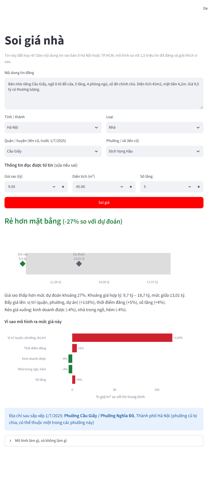
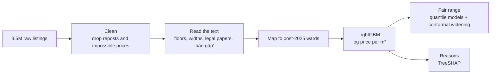

# soi-gia-nha

[](https://github.com/HongTin2104/soi-gia-nha/actions/workflows/ci.yml)

**Is this listing overpriced?** Paste a house or apartment listing from Hanoi or Ho Chi Minh
City and get a fair price range, a verdict, and the reasons behind it. Trained on 1.5 million
real listings from June 2025 to March 2026.

<p align="center"></p>

## Why

Someone looking at *"Bán nhà 5 tầng Cầu Giấy, 45m², 9,5 tỷ"* has no quick way to tell whether
that is a good price. The usual answer is to scroll through hundreds of similar listings.
Listing sites show a price, sometimes a price per m², never *why* a place costs what it costs.

On top of that, Vietnam merged its provinces and wards on 1 July 2025. Listings still use the
old ward names, while maps and documents now use the new ones.

This project answers three questions for a single listing:

1. **What is a fair asking price here?** A range, not one number.
2. **Why?** Which details push the price up or down, in percent.
3. **Where is it now?** The ward after the 2025 reorganisation.

## Data

| | |
|---|---|
| Listings | [tinixai/vietnam-real-estates](https://huggingface.co/datasets/tinixai/vietnam-real-estates), 3,500,744 listings for sale, June 2025 to March 2026, CC BY-NC 4.0 |
| Used in v0.1 | Hanoi and Ho Chi Minh City: **1,515,980** listings after cleaning |
| Administrative units | Old units from [daohoangson/dvhcvn](https://github.com/daohoangson/dvhcvn), old → new wards from [dvhcvn/20250701](https://github.com/dvhcvn/20250701) |

Almost a third of the raw listings are reposts of the same property. They are removed before
anything else, otherwise the same house ends up in both the training and the test data.
The full cleaning funnel, bounds and column list are in [data/DATASET.md](data/DATASET.md).

## How it works



**Reading the listing text.** Floors are missing in 76% of listings, road width in 85%. Sellers
usually write them in the description anyway: *"nhà 5 tầng"*, *"trệt 2 lầu"* (southern
counting: ground floor + 2), *"hẻm xe hơi"*, *"sổ hồng riêng"*. Regular expressions recover
them, checked against the listings where the seller also filled in the field
([reports/text_extraction.md](reports/text_extraction.md)):

| Field | Agrees with seller-entered value | Missing before → after |
|---|---:|---:|
| Floors | 88.9% | 76.4% → 40.7% |
| Bedrooms | 87.8% | 39.8% → 33.3% |
| Frontage width | 94.9% (±0.5 m) | 51.8% → 49.4% |
| Road / alley width | 88.7% (±0.5 m) | 84.8% → 76.7% |

**Price model.** LightGBM predicts log price per m² from location (district, ward, project,
smoothed ward and district medians), size, building details and the text flags. Price per m²
keeps a 30 m² flat and a 300 m² plot on the same scale; area stays in as a feature.

**Fair range.** Two extra LightGBM models predict the 10th and 90th percentile. Quantile models
are usually too confident on a later month, so the range is widened on the February validation
data until it covers 80% of asking prices there (conformalized quantile regression).

**Reasons.** TreeSHAP values from LightGBM itself, grouped into things a buyer recognises
(location, size, floors, car access, legal papers...). Each one reads as *"this makes the price
per m² X% higher than an average listing in the data"*.

## Results

Trained on June 2025 to January 2026, tested on **March 2026** (160,891 listings the model never
saw), the same situation as checking a new listing. Errors are relative to the asking price.
Full tables in [reports/model.md](reports/model.md).

| Model | Median error | Within 10% | Within 20% |
|---|---:|---:|---:|
| Median price per m² of the district | 23.2% | 23.1% | 43.9% |
| Median price per m² of the ward | 20.1% | 26.2% | 49.8% |
| **LightGBM** | **11.6%** | **44.7%** | **70.1%** |

| | Hanoi | Ho Chi Minh City |
|---|---:|---:|
| Apartments | 6.4% | 7.6% |
| Houses | 14.6% | 13.5% |
| Land | 16.5% | 15.6% |

The fair range contains the asking price for 77.5% of March listings (80% targeted).
Apartments are the easiest to price, they are similar to each other and the project name
carries a lot of information. Land and houses depend on details listings rarely state:
the exact alley, the shape of the plot, the condition of the building.

One finding from [reports/checks.md](reports/checks.md): listings that say *"bán gấp"* or
*"cắt lỗ"* are only marginally cheaper than similar listings (−0.5% vs −0.1% for the rest).
The words alone are not a reason to expect a discount.

## Run it

```sh
git clone https://github.com/HongTin2104/soi-gia-nha
cd soi-gia-nha
pip install -e ".[app]"
streamlit run app/app.py
```

The trained model (~80 MB download) is fetched from the
[model-v0.1 release](https://github.com/HongTin2104/soi-gia-nha/releases/tag/model-v0.1) on
first start. With Docker:

```sh
docker build -t soi-gia-nha .
docker run -p 7860:7860 soi-gia-nha   # then open http://localhost:7860
```

From Python:

```python
from soi_gia_nha.assets import ensure_model
from soi_gia_nha.explain import check, summary_vi
from soi_gia_nha.listing import build
from soi_gia_nha.model import PriceModel

model = PriceModel.load(ensure_model())
listing = build(
    "Bán nhà 4 tầng hẻm xe hơi 60m2 giá 8,5 tỷ",
    province="Hồ Chí Minh", district="Gò Vấp", property_type="Nhà",
)
print(summary_vi(check(model, listing)))
```

```
Giá rao nằm trong khoảng hợp lý. Khoảng giá hợp lý: 7,02 tỷ – 9,58 tỷ, mức giữa 7,91 tỷ.
Đẩy giá lên: số tầng (+10%), thời điểm đăng (+6%), số phòng (+5%).
Kéo giá xuống: vị trí (quận, phường, dự án) (-8%), nhà trong ngõ, hẻm (-3%).
```

### Reproduce everything

About half an hour and 16 GB of RAM on a laptop, no GPU needed.

```sh
pip install -e ".[dev]"
python scripts/download.py      # 1.7 GB of parquet into data/raw/
python scripts/prepare.py       # clean, read text, map wards -> data/processed/
python scripts/eval_text.py     # reports/text_extraction.md
python scripts/train.py         # models/v0.1/ and reports/model.md
python scripts/eval_checks.py   # reports/checks.md
pytest
```

`notebooks/01_eda.ipynb` is where the cleaning rules come from.

## Project layout

```
src/soi_gia_nha/
  data.py      download and load the raw shards (pinned dataset revision)
  clean.py     filters and repost removal
  text.py      floors, widths and flags from the listing text
  admin.py     old address -> post-2025 ward
  model.py     LightGBM models, fair range, save/load
  explain.py   verdict, TreeSHAP reasons, Vietnamese summary
  listing.py   turn a pasted listing into a model row
  assets.py    fetch the trained model from the release
app/app.py     Streamlit demo
scripts/       pipeline steps, each writes its own report
reports/       numbers quoted in this README
```

## Limitations

- **Asking prices, not sale prices.** The tool compares a listing with other listings. It is
  not a valuation, and the real transaction price is usually lower.
- Only Hanoi and Ho Chi Minh City, and only what was listed between June 2025 and March 2026.
  The market moves; the model needs retraining to stay current.
- A wide range is an honest answer: without the ward, project or floors the model knows less.
- Reasons are relative to an average listing in the data, not to the neighbouring houses.
- 39% of listings sit in an old ward that was split; the app then shows every candidate new ward.
- Text extraction is rule-based. It misses unusual phrasing and can misread numbers.

Ideas for later: other cities, rental listings, a learned extractor for the description text,
alerts for new listings below the fair range.

## Dành cho sinh viên

Repo này có thể dùng làm tài liệu tham khảo cho đồ án môn Học máy, Khai phá dữ liệu hay Xử lý
ngôn ngữ tự nhiên. Một vài điểm nên xem:

- **Chia dữ liệu theo thời gian, không chia ngẫu nhiên.** Tin đăng lại (chiếm gần 1/3 dữ liệu)
  mà nằm ở cả tập train lẫn tập test thì kết quả sẽ đẹp giả. Xem `clean.py` và `model.time_split`.
- **Luôn so với baseline.** Trung vị giá/m² theo phường đã sai số 20%; mô hình chỉ có giá trị
  khi tốt hơn rõ rệt so với cách đơn giản đó.
- **Khoảng dự đoán phải được kiểm tra.** Khoảng 10–90% của mô hình quantile ban đầu chỉ đúng
  70% trên tháng mới; hiệu chỉnh conformal đưa lên 77,5%.
- **Giải thích bằng SHAP** không cần thư viện `shap`: LightGBM có sẵn `pred_contrib=True`.
- Mỗi con số trong README đều do một script trong `scripts/` sinh ra; chạy lại sẽ ra cùng kết quả.

Nếu dùng lại code hoặc kết quả trong báo cáo, hãy trích dẫn repo này và bộ dữ liệu của TiniX AI.

## Citation

```bibtex
@software{soi_gia_nha,
  author = {HongTin2104},
  title  = {soi-gia-nha: explainable price checks for Vietnamese real estate listings},
  year   = {2026},
  url    = {https://github.com/HongTin2104/soi-gia-nha}
}
```

## License

Code: [MIT](LICENSE). The listings and the trained model are derived from the TiniX AI dataset
and are **CC BY-NC 4.0**: non-commercial use only, with credit to
[TiniX AI](https://tinix.ai/).
